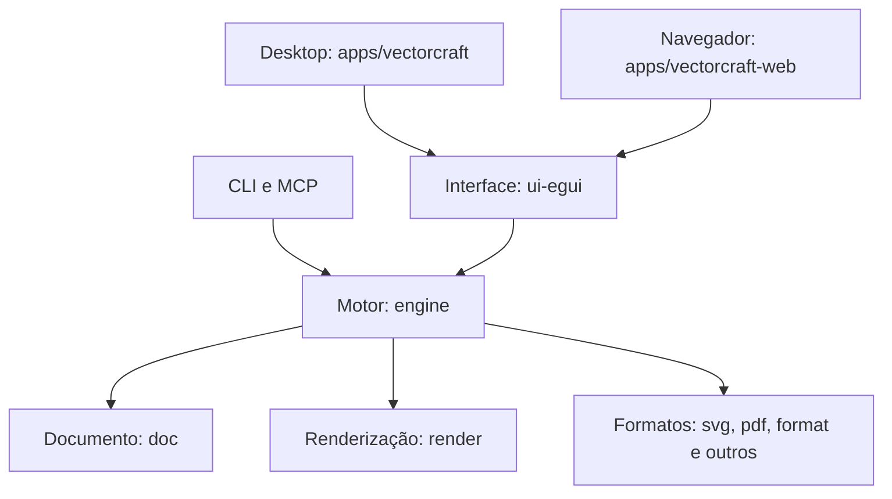

# Vector Machine

Fork independente do [VectorCraft](https://github.com/storytold/vectorcraft), criado originalmente pela equipe ArtCraft. Editor vetorial em Rust para desktop e navegador (WebAssembly). Este fork não é um produto oficial da ArtCraft nem da Adobe.

**Estado:** preparação da base, ainda em alpha. Os nomes dos crates, executáveis, preferências e arquivos `.vectorcraft` continuam iguais aos do upstream para preservar compatibilidade. A identidade visual completa do aplicativo ainda está pendente. Não há release próprio publicado.

## Fluxo de desenvolvimento

- `main`: referência inicial herdada do fork; não é nosso destino de PRs.
- `develop`: integração. Criar branches de trabalho e abrir PRs para esta branch.
- `master`: versão aprovada pelo Jamison. Promoção e merge ficam com ele.

O GitHub ainda pode mostrar `main` como branch padrão. Em **Settings → General → Default branch**, selecionar `develop` para sugerir o destino correto dos PRs. Em **Settings → Rules → Rulesets**, proteger `develop` e `master`, exigir PR e os checks da CI; conceder bypass de `master` somente ao responsável por releases. Esses ajustes administrativos não são aplicados pelo workflow.

## O que é o aplicativo

O Vector Machine tem uma versão **desktop nativa** e uma versão **web**, com o mesmo motor em Rust. Não usa Electron, Angular ou React. A interface é construída com `egui`; `eframe` integra essa interface à janela do sistema ou ao navegador.

| Versão | Execução | Interface e gráficos |
|---|---|---|
| Desktop | Executável compilado para Windows, macOS ou Linux | `egui`/`eframe` com `wgpu` |
| Web | Rust compilado para WebAssembly (WASM), executado no navegador | A mesma interface; WebGPU com alternativa WebGL2 |
| Linha de comando | Executável `vectorcraft-cli`, sem necessidade de abrir janela | Motor compartilhado para processamento, exportação e MCP |

A versão web não exige um servidor de aplicação ou banco de dados: os arquivos compilados podem ser hospedados em um servidor estático. Abrir, salvar e exportar usam os recursos do navegador. O canal TCP de controle da versão desktop não está disponível no navegador.

## Como rodar

### 1. Preparar as ferramentas

Instalar Rust pelo [rustup](https://rustup.rs/). O workspace exige **Rust 1.95 ou superior**, edição 2024. `Cargo` é o gerenciador de dependências, compilação e testes do Rust; ele vem com a instalação.

```sh
rustup update stable
rustc --version
cargo --version
```

| Sistema | Requisitos para compilar a versão desktop |
|---|---|
| Windows | Rust com toolchain MSVC e Visual Studio Build Tools, com a carga de trabalho de desenvolvimento desktop em C++ e Windows SDK |
| macOS | Command Line Tools do Xcode: `xcode-select --install` |
| Debian/Ubuntu | Compilador C/C++, `pkg-config` e bibliotecas de janela/gráficos, conforme o comando abaixo |

No Debian/Ubuntu:

```sh
sudo apt-get update
sudo apt-get install -y build-essential pkg-config libxkbcommon-dev libwayland-dev libx11-dev libxrandr-dev libxi-dev libgl1-mesa-dev
```

### 2. Baixar o repositório

```sh
git clone https://github.com/JamisonDuartedaSilva/Vector-Machine.git
cd Vector-Machine
git switch develop
```

Os comandos a seguir partem da raiz do repositório, exceto quando indicam outra pasta. A primeira compilação baixa dependências e demora mais; as seguintes reutilizam o cache local. `--locked` exige que as versões de dependências correspondam ao `Cargo.lock`.

### 3. Rodar no desktop

```sh
cargo run --locked --release -p vectorcraft
```

Para abrir um exemplo junto com o aplicativo:

```sh
cargo run --locked --release -p vectorcraft -- examples/dusk-poster.vectorcraft
```

Para compilar sem abrir a janela:

```sh
cargo build --locked --release -p vectorcraft
```

O executável fica em `target/release/vectorcraft` no Linux/macOS ou `target/release/vectorcraft.exe` no Windows. Esse comando gera o executável, não um instalador. Para desenvolver, pode-se omitir `--release`; para avaliar desempenho, usar a compilação de release.

### 4. Rodar no navegador

Adicionar o destino WASM e instalar o Trunk, que prepara o pacote web:

```sh
rustup target add wasm32-unknown-unknown
cargo install trunk --version 0.21.14 --locked
cd apps/vectorcraft-web
trunk serve --release --locked
```

Abrir **http://127.0.0.1:8766**. O Trunk observa os arquivos e recompila após mudanças. Para voltar à raiz, executar `cd ../..`.

Para gerar um pacote estático, dentro de `apps/vectorcraft-web`:

```sh
trunk build --release --locked
```

A saída fica em **`dist/web` na raiz do repositório**, conforme [Trunk.toml](apps/vectorcraft-web/Trunk.toml). Inclui HTML, WASM e código JavaScript gerado pelas ferramentas de integração, sem uma aplicação JavaScript escrita à mão.

Para servir o pacote compilado, voltar à raiz e executar:

```sh
python3 -m http.server 8766 --directory dist/web
```

No Windows, se Python estiver disponível pelo lançador `py`, usar `py -m http.server 8766 --directory dist/web`. Abrir o endereço pelo servidor HTTP, em vez de abrir o HTML diretamente por `file://`. Salvar ou exportar o trabalho antes de fechar a aba.

### 5. Usar a linha de comando e o MCP

Na raiz, exportar um exemplo sem abrir a interface:

```sh
mkdir -p out
cargo run --locked --release -p vectorcraft-cli -- run --in examples/dusk-poster.vectorcraft --export out/exemplo.png
```

No PowerShell, criar a pasta com `New-Item -ItemType Directory -Force out` no lugar de `mkdir -p out`.

Para iniciar o servidor MCP com motor interno, sem interface:

```sh
cargo run --locked --release -p vectorcraft-cli -- mcp --headless
```

Esse processo espera mensagens de um cliente MCP na entrada padrão; não abre uma página web. Para controlar o aplicativo visível, iniciar o desktop em um terminal e o MCP em outro:

```sh
cargo run --locked --release -p vectorcraft -- --control 7979
cargo run --locked --release -p vectorcraft-cli -- mcp --connect 127.0.0.1:7979
```

O registro no cliente de IA e as opções `--automation-read-root`/`--automation-write-root`, que limitam acesso a arquivos, estão em [docs/mcp.md](docs/mcp.md).

### Fontes e problemas comuns

- **Cargo ou Trunk não encontrado:** reabrir o terminal após a instalação e conferir se a pasta de executáveis do Cargo está no `PATH`.
- **Erro de compilador/linker:** conferir a versão do Rust e os requisitos nativos do sistema na tabela acima.
- **Destino WASM ausente:** executar `rustup target add wasm32-unknown-unknown`.
- **Problema gráfico no navegador:** tentar o endereço com `?webgl`, que força a alternativa WebGL2.
- **Caracteres sem fonte:** o projeto aceita as fontes opcionais do repositório [craft-fonts](https://github.com/storytold/craft-fonts), por `CRAFT_FONTS_DIR` com caminho absoluto. No desktop, também usa fontes instaladas no sistema. A configuração completa está em [docs/development.md](docs/development.md).

## Arquitetura

O repositório é um **workspace Cargo**: um conjunto de pacotes Rust, chamados *crates*. As bibliotecas ficam em `crates/`; os pontos de entrada do aplicativo ficam em `apps/`. Para quem vem de .NET, o workspace se aproxima de uma solution e cada crate, de um projeto com seu próprio manifesto e dependências.

O motor não depende da interface gráfica. Desktop, web e linha de comando reutilizam o modelo de documento, os comandos, os importadores e a renderização.



### Pastas e responsabilidades

Os nomes de crates na tabela omitem o prefixo `vectorcraft-`.

| Camada/pasta | Responsabilidade |
|---|---|
| `crates/geom`, `crates/color` — L0 | Curvas, transformações, modelos de cor e conversões |
| `crates/affinity`, `crates/scriptcheck` — independentes | Leitura de documentos Affinity e verificação de scripts; não dependem de outros crates do workspace |
| `crates/doc` — L1 | Modelo de dados: pranchetas, camadas, objetos, texto e aparência |
| `crates/pathops`, `brush`, `trace`, `text`, `effects`, `plugins`, `three-d` — L2 | Operações entre formas, pincéis, vetorização de imagens, tipografia, efeitos, plug-ins WASM e recursos 3D |
| `crates/render`, `svg`, `pdf`, `format`, `eps`, `cad`, `metafile` — L3 | Renderização em pixels e leitura/escrita dos formatos suportados |
| `crates/tools` — L4 | Estado das ferramentas: recebe eventos de ponteiro e produz comandos e elementos de pré-visualização |
| `crates/engine` — L5 | Sessões, seleção, histórico de desfazer/refazer, registro de comandos e operações de arquivo |
| `crates/ui-egui` — L6 | Menus, painéis, diálogos, tela de desenho e traduções da interface |
| `crates/mcp` — L6 | Protocolo MCP para agentes, usando o mesmo motor |
| `apps/vectorcraft` | Inicialização e integração desktop: janela, GPU, área de transferência e serviços do sistema |
| `apps/vectorcraft-web` | Inicialização no navegador: WASM, arquivos, downloads e recursos web |
| `apps/vectorcraft-cli` | Exportação e processamento sem interface, medições de desempenho e servidor MCP |
| `crates/testkit` | Utilitários compartilhados de teste; usado como dependência de desenvolvimento |
| `xtask/` | Ferramentas do workspace, como verificações de camadas, assets e compilação WASM |
| `assets/`, `examples/` | Recursos visuais e documentos de exemplo, atribuídos em `ASSETS.md` |
| `docs/`, `packaging/`, `.github/workflows/` | Documentação detalhada, empacotamento e automação do GitHub |

As dependências seguem as camadas inferiores, com exceções explícitas entre crates da mesma camada. Crates abaixo de L6 não dependem de bibliotecas de interface. As regras exatas estão em [xtask/src/layers.rs](xtask/src/layers.rs); `cargo xtask layers` verifica essa separação.

### Como uma ação chega ao documento

Uma interação com ferramenta ou painel chega ao motor como comando. Os comandos do editor ficam em `crates/engine/src/cmd/`: definem parâmetros, disponibilidade e execução. A interface lê o estado do motor e solicita ações, em vez de implementar novamente as regras de edição. Comandos exclusivos da interface ficam em `crates/ui-egui/src/menus.rs`.

Isso permite reutilizar uma ação pela interface, pela CLI ou pelo MCP. O histórico usa compartilhamento estrutural do documento para evitar copiar todos os dados a cada alteração. O comando `command.batch` agrupa várias operações em um passo de desfazer.

### Como a imagem é desenhada

O crate `render` transforma o documento em pixels com `vello_cpu`. No desktop, ele usa processamento em múltiplas threads e caches por objeto/efeito; a GPU, via `wgpu`, compõe a imagem resultante e desenha a interface. Portanto, ter suporte a GPU não significa que toda a geometria vetorial já seja rasterizada nela. No WASM, a configuração de multithreading do renderer nativo não é habilitada.

O formato nativo `.vectorcraft` usa JSON versionado e comprimido, com imagens embutidas. O projeto também mantém compatibilidade com o antigo nome `.drawcraft`. Os módulos de formatos lidam com importação e exportação; o suporte exato varia por formato.

### Onde mexer ao implementar uma funcionalidade

| Mudança | Ponto de partida |
|---|---|
| Menu, painel ou diálogo | `crates/ui-egui` |
| Regra de edição ou nova ação | `crates/engine/src/cmd` e testes do motor |
| Comportamento da caneta ou seleção | `crates/tools`, integrado aos comandos do motor |
| Desempenho de desenho | `crates/render`, medindo antes/depois com a CLI |
| Importação/exportação | Crate correspondente ao formato e registro no motor |
| Integração com sistema ou navegador | Aplicativo correspondente em `apps/` |

Mais detalhes estão em [docs/architecture.md](docs/architecture.md) e [docs/development.md](docs/development.md); esses documentos herdados permanecem em inglês.

## Verificações locais

A pipeline cotidiana é enxuta. Para uma mudança de código, executar localmente os testes e verificações pertinentes. Exemplos:

```sh
cargo fmt --all -- --check
cargo test --locked -p vectorcraft-engine
cargo xtask layers
```

A validação ampla do upstream continua disponível por `cargo xtask ci`, mas não faz parte da CI cotidiana deste fork. Não é necessário recompilar o aplicativo para uma alteração apenas no README.

## GitHub Actions

[Vector Machine CI](.github/workflows/vector-machine-ci.yml) roda em PRs para `develop`/`master`, pushes nessas branches e execução manual:

1. Um único job compila a versão web com dependências travadas e cache de Rust.
2. Verifica que o HTML e o WASM foram gerados, que o lockfile não mudou e envia `vector-machine-web` como artefato, retido por sete dias.

A CI cotidiana não executa `cargo xtask ci`, Clippy, a suíte inteira de testes ou builds desktop. Esses comandos continuam disponíveis para validação local e mudanças que precisem deles. Alterações apenas em documentação não disparam o build; execução manual permanece disponível. Novas execuções cancelam a anterior da mesma branch/PR. O job tem limite de 30 minutos, não uma estimativa de duração; a primeira compilação sem cache pode levar mais tempo.

O artefato pode ser baixado em **Actions → execução → Artifacts** e servido por um servidor estático. Não há deploy, publicação de releases ou merge automático. A primeira execução precisa ser aprovada no GitHub se os Actions estiverem desativados no fork. Nenhum secret é necessário nesta etapa.

Os workflows herdados continuam no repositório, mas seus jobs estão limitados ao upstream `storytold/vectorcraft`. Isso evita ativar neste fork os agendamentos e instaladores oficiais, inclusive runners maiores. Teremos uma pipeline própria de distribuição quando a identidade do aplicativo estiver pronta.

## Atualizar a base

```sh
git remote add upstream https://github.com/storytold/vectorcraft.git
git fetch upstream
git switch develop
git switch -c chore/update-upstream
git merge upstream/main
cargo xtask ci
git push -u origin chore/update-upstream
```

Abrir PR para `develop` e revisar conflitos, workflows e branding. Se o remote `upstream` já existir, omitir o primeiro comando. Não substituir nossas branches nem fazer force-push.

## Limitações e licença

A compatibilidade com `.ai` ainda é parcial; a presença de uma ferramenta não implica paridade completa com o Illustrator. As avaliações e o roadmap herdados descrevem o upstream, não resultados medidos deste fork: [ROADMAP.md](ROADMAP.md), [docs/gaps.md](docs/gaps.md).

Código sob **MIT ou Apache-2.0**, à escolha. Mantidos [LICENSE-MIT](LICENSE-MIT), [LICENSE-APACHE](LICENSE-APACHE), [NOTICE](NOTICE) e [ASSETS.md](ASSETS.md). As imagens de marca ArtCraft foram removidas; atribuições e licenças de terceiros permanecem. Respeitar as regras de implementação independente e de assets em [AGENTS.md](AGENTS.md).
